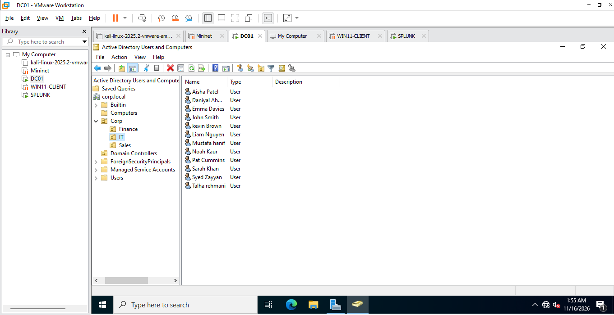
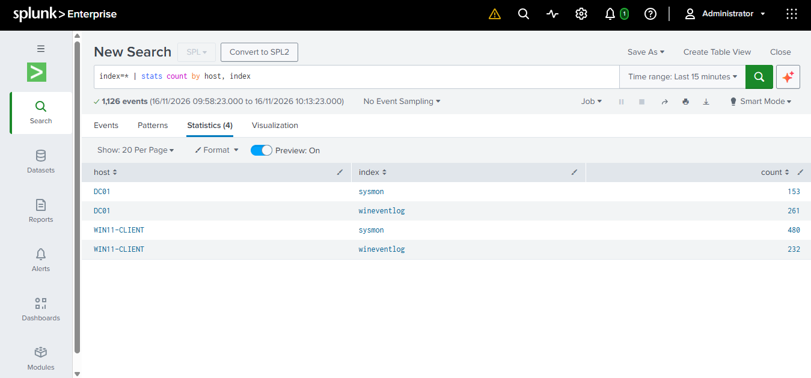
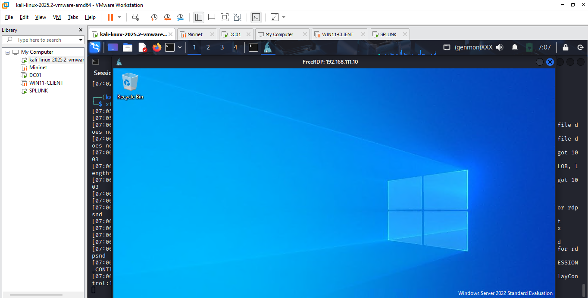
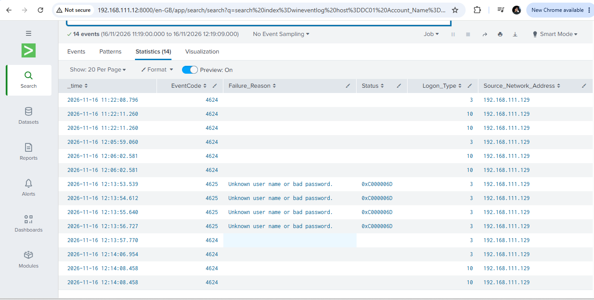

# Cybersecurity Home Lab: AD Monitoring & Brute-Force Detection

A self-built lab simulating a small company network, instrumented for security 
monitoring, used to demonstrate log analysis and incident detection skills.

## Goal

Build an isolated Active Directory network, monitor it with Sysmon and Splunk, 
simulate a brute-force attack, detect it, and document the investigation.

## Architecture

| Machine | Role | OS |
|---|---|---|
| DC01 | Domain Controller (corp.local) | Windows Server 2022 |
| WIN11-CLIENT | Employee workstation | Windows 11 Pro |
| SPLUNK | SIEM / log server | Ubuntu Server 22.04 |
| Kali | Attacker machine | Kali Linux |

All machines run on an isolated host-only network (VMnet1, 192.168.111.0/24), 
with no route to the internet from the lab subnet itself.

## What's Built

- Active Directory domain `corp.local` with OU structure (IT, Finance, Sales) 
  and 36 user accounts
- Sysmon deployed on DC01 and WIN11-CLIENT using the SwiftOnSecurity baseline config
- Splunk Enterprise deployed as a dedicated SIEM, receiving forwarded logs 
  from both Windows hosts via Splunk Universal Forwarder
- Verified log ingestion: Security Event Log and Sysmon Operational log, 
  both hosts, both indexes




## Attack Simulation: Brute-Force Against a Domain Account

A controlled brute-force attack was run from Kali against the domain account 
`j.smith`, targeting RDP on DC01, using a 5-entry wordlist (4 wrong 
passwords, then the correct one).

hydra -l j.smith -P passwords.txt rdp://192.168.111.10 -t 1 -V -f


The attack produced 4 failed logon attempts in under 4 seconds, followed by 
a successful network authentication, and then a full interactive RDP 
session, confirmed by connecting with a real RDP client and the discovered 
credentials (Event ID 4624, Logon Type 10):



## Detection in Splunk

Failed and successful logon events were correlated using Windows Security 
Event IDs 4625 (failed) and 4624 (successful):



A detection search was built to flag any account with 3 or more failed 
logons within a 1-minute window:

```spl
index=wineventlog host=DC01 EventCode=4625 Account_Name=j.smith
| bin _time span=1m
| stats count as failed_logons by _time, Account_Name
| where failed_logons >= 3 AND Account_Name!="-"
```


This was saved as a scheduled Splunk alert, running every 5 minutes, so 
this pattern would be flagged automatically rather than requiring manual 
log review:


**Full write-up, including the attack timeline and two real permission 
issues diagnosed and fixed during the investigation, is in 
[docs/incident-report.md](docs/incident-report.md).**

## What I Learned

- Windows Event ID 4625 carries different failure reasons (Status codes) for 
  different causes, wrong password, lockout, and permission/logon-type 
  restrictions all look similar at a glance but need different responses.
- On a Domain Controller, RDP logon rights are governed by the Default 
  Domain Controllers Policy, which can silently override local group 
  membership if left unconfigured.
- Tooling isn't always reliable, Hydra's RDP module is explicitly 
  experimental, and cross-verifying with a real RDP client was necessary 
  to confirm an actual session was established.
- A simple time-windowed correlation search is a practical way to detect 
  brute-force patterns, and the same technique generalizes to other 
  services (SSH, web login, VPN).

## Skills Demonstrated

- Active Directory administration (OUs, user provisioning, domain join, 
  Group Policy)
- Endpoint monitoring with Sysmon
- SIEM deployment and log forwarding (Splunk Universal Forwarder, index 
  management, receiving configuration)
- Linux server administration (Ubuntu, LVM disk management, networking, SSH)
- Log analysis and incident detection using Windows Security Event IDs
- Building and saving Splunk correlation searches and alerts
- Troubleshooting (diagnosed a Windows Event Log permission error, 
  errorCode=5, on the forwarder service account; diagnosed and resolved a 
  Default Domain Controllers Policy restriction blocking RDP access)

## Notes

Lab credentials are placeholders throughout and not included in this repo.
